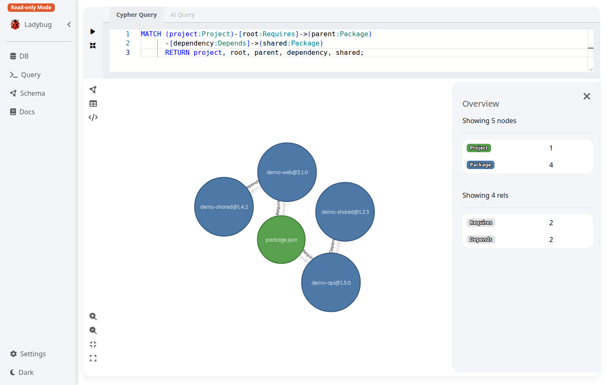

# Lady

Lady is a set of Linux tools for understanding a software project, running work
in a controlled environment, building its operating-system image, and publishing
reviewed changes.

## Why it exists

A dependency inventory answers what a project declares. It does not tell you
what an agent may download or execute, whether its sandbox enforces that policy,
or which changes are ready to publish. Lady keeps those decisions explicit and
connects them through checked inputs, locks and retained results.

Use the tools independently, or combine them for a workflow in which source
analysis, execution, system construction and host credentials have separate
owners.

| Tool | Use it to | Guide |
| --- | --- | --- |
| **Ladybom** | Inventory Cargo, Python, npm and Go source metadata; export SBOMs; inspect dependency graphs and supplied security advisories | [CLI](crates/ladybom-cli/README.md) · [Rust API](crates/ladybom/README.md) |
| **Ladyshell** | Prepare authorized OpenShell environments, run tasks and retain their state and exports | [Usage](docs/usage.md) |
| **Ladyboot** | Describe system needs in Nickel and build bootc OS images with Nix | [Profiles and images](crates/ladyboot/README.md) |
| **Ladyhost** | Keep GitHub credentials and signing keys on the host; publish and integrate reviewed Jujutsu commits | [Host workflow](crates/ladyhost/README.md) |

## Start with an inventory

You need Linux, stable Rust, a C compiler and Git. This path does not require
Nickel, Nix, OpenShell or a model provider. Cargo's first build may download
packages; scanning itself does not access the network or execute project code.

```sh
git clone https://github.com/f1b0-gh/lady.git
cd lady
cargo build -p ladybom-cli --locked
./target/debug/ladybom scan --project /absolute/path/to/project --json
```

For a CycloneDX SBOM, write outside the scanned project:

```sh
./target/debug/ladybom scan --project /absolute/path/to/project \
  --cyclonedx > /absolute/path/outside-project/bom.cdx.json
```

Read the report's coverage and diagnostics. Unsupported inputs and unresolved
identities remain gaps; a successful scan is not a security clearance.
Go scans read `go.mod`, `go.work`, checksum and vendor metadata without running
Go. These source inventories remain unlocked: checksums do not establish the
selected build list, and resolution or advisory coverage gaps stay explicit.
Nix/Go artifacts use a separate,
[explicit collection workflow](docs/artifact-sbom.md).

## Inspect dependency differences



This is the real [Ladybug Explorer](https://github.com/LadybugDB/explorer),
showing CSV exported by Ladybom from the [reproducible example](examples/explorer-demo/README.md).
Its deliberately synthetic npm lockfile illustrates a small static audit:

| Evidence | Finding |
| --- | --- |
| Declared minimums | Node `>=20`; `demo-api` requests `^1.0.0`, while its locked version is `1.3.0`. A range's lower bound is not the installed version. |
| Version divergence | `demo-api@1.3.0` reaches `demo-shared@1.2.3`; `demo-web@2.1.0` reaches `demo-shared@1.4.2`. |
| Common declared lower bound | The parents' `^1.2.0` and `^1.4.0` ranges overlap from stable version `1.4.0` up to, but excluding, `2.0.0`. This is a constraint calculation, not a tested safe minimum. |
| Before/after difference | The comparison fixture has three package nodes instead of four: it removes the nested `1.2.3` copy and redirects the API's edge to `1.4.2`. |

```sh
sh examples/explorer-demo/prepare.sh /tmp/lady-demo-inputs
./target/debug/ladybom graph export --project /tmp/lady-demo-inputs/before --output /tmp/lady-demo-before
./target/debug/ladybom graph export --project /tmp/lady-demo-inputs/after --output /tmp/lady-demo-after
./target/debug/ladybom graph alignment-plan --snapshot /tmp/lady-demo-before --markdown
./target/debug/ladybom graph diff --before /tmp/lady-demo-before --after /tmp/lady-demo-after
```

Use new output directories. The example does not select a safe version or prove
compatibility, minimum-version support, or an actual installation. Real changes
need complete constraints, current advisory checks and consumer tests; the
[graph guide](docs/dependency-graphs.md) explains the limits and validation path.

## How it works

1. **Observe.** Ladybom reads bounded source snapshots and produces an inventory.
   Graph and advisory analysis use those recorded identities and their limits.
2. **Authorize and run.** Ladyshell checks the inventory against an independently
   selected source scope. An explicit configuration controls tools, permissions
   and checks. `lock → plan → apply` prepares the environment; execution requires
   verified identity, effective confinement and any required provider.
3. **Retain and review.** Results and exports remain available for inspection.
   Ladyhost performs forge and signing operations on the host, then verifies the
   selected commits and review policy before integration.

Ladyboot is a separate system-build path: Nickel validates needs, Nix selects
pinned packages and assembles the image, and Rust locks inputs and verifies
artifact receipts. Ladyshell can invoke its CLI, but has no Cargo dependency on
Ladyboot. A report never grants installation or network permission.

## Build and contribute

```sh
cargo build --workspace --locked
```

The repository includes an unchanged, commit-pinned `nickel-util` source bundle
from [Nickeling](https://github.com/f1b0-gh/nickeling). No sibling checkout is
required. See the [build guide](docs/development.md) for source verification,
test prerequisites, required checks and known dependency findings.

See the component guides for usage and validation details.

[Documentation](docs/README.md) · [Contributor rules](AGENTS.md)

## License

[Apache-2.0](LICENSE). Bundled third-party code retains its notices, including
[Nickeling](vendor/nickel-util/LICENSE) and the
[MIT audit validator](crates/ladyshell/src/audit/validator/LICENSE-MIT).
