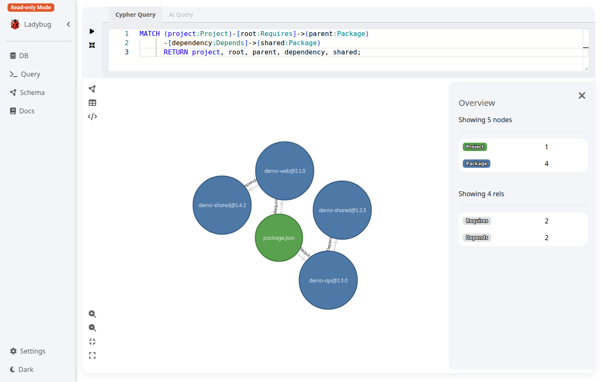

# ladybom CLI

The inventory command for [Ladybom](../ladybom/README.md). The Cargo package is
`ladybom-cli`; its binary is `ladybom`. From the repository root:

```sh
cargo build -p ladybom-cli --locked
./target/debug/ladybom scan --project /absolute/project --json
./target/debug/ladybom scan --project /absolute/project --cyclonedx
```

Examples below assume the binary is on `PATH`; otherwise use
`./target/debug/ladybom`. Use `ladybom --help` or, for example,
`ladybom graph query --help` for command-specific syntax. Keep outputs
outside scanned sources. Native JSON is the input to `ladyshell --ladybom`;
CycloneDX is an exchange format and does not replace that report.

## Commands and exit status

| Group | Purpose |
| --- | --- |
| `scan` | Static inventory, optionally restricted by source selection |
| `graph` | Snapshots, traversal, version alignment and baseline policy |
| `prune` | Usage evidence, removal simulation and validation plans |
| `vuln` | Local OSV import, assessment, policy and VEX |
| `interop` | Exchanges partitioned by independent lockfile |
| `vxdf` | Experimental untrusted import and explicitly reviewed export |
| `artifact` | Explicit Nix/Go collection and offline SBOM export |

Code **0** means the requested operation completed or its policy passed;
**2** means refused input, incomplete analysis or failed policy; **1** means an
operational failure. Complete `scan`, `alignment` or `vuln assess` results may
still contain findings. Use the corresponding checks for policy decisions.
CLI-managed file outputs refuse replacement; shell redirection (`>`) can overwrite
files. A published partial report is not approval. Value-taking inputs below are
required unless marked optional or given a default; switches such as `--json`
and `--check` are optional. Most analyses write JSON to stdout;
commands with optional `--output` write a new JSON file instead when it is supplied.

## Source inventory

| Option | Meaning |
| --- | --- |
| `--project DIR` | Source root to inventory; scanning never runs a package manager or accesses the network. |
| `--sources FILE` | Optional JSON selection of source paths; without it, use the normal bounded project snapshot and its protected exclusions. |
| `--json` | Emit the native report instead of the default human-readable summary. |
| `--cyclonedx` | Emit CycloneDX 1.5 JSON instead of the summary; conflicts with `--json`. |
| `--export-profile public\|private-detailed` | Only with `--cyclonedx`; default `public` controls exported detail, not which sources are scanned. |

```sh
ladybom scan --project /absolute/project --sources /absolute/sources.json --json
ladybom scan --project /absolute/project --cyclonedx > /outside-project/bom.cdx.json
```

`--sources` accepts a strict JSON object such as
`{"include":["src","Cargo.toml","Cargo.lock"],"exclude":["src/runtime"]}`.
Paths are relative and normalized, without `..`; protected exclusions remain
active. Selected symlinks are refused and excluded paths are not traversed.
The selection file is limited to 1 MiB, with no symlink in its path. Use the
same scope as the Ladyshell mission, which independently verifies the report.

`--cyclonedx` and `--json` are exclusive. The default CycloneDX 1.5 profile is
`public`; `--export-profile private-detailed` includes native details that may
contain secrets. Unresolved constraints do not become component versions.
Composition stays `unknown` or `incomplete`; `ladybom:complete` describes parsing.
A partial SBOM is written with exit code 2. Native JSON reports are version 2;
graph snapshots remain version 1 with a version 2 inventory.

Cargo, Python, npm and Go metadata are inventoried statically. Go reads `go.mod`,
`go.work`, checksums and vendor metadata, but never runs Go or resolves the selected
build list. Requirements are minimum versions, checksums are not locks, and
vendored modules are observations. Local `use`/`replace` targets must already be
in the selected snapshot. Go projects remain unlocked, resolution gaps remain
explicit, and Go advisory matching is unsupported. See
[dependency coverage](../../docs/dependencies.md) for format-specific limits.

## Inspect dependency differences



This is the real [Ladybug Explorer](https://github.com/LadybugDB/explorer),
showing CSV exported by Ladybom from the [reproducible example](../../examples/explorer-demo/README.md).
Its deliberately synthetic npm lockfile illustrates a small static audit:

| Evidence | Finding |
| --- | --- |
| Declared minimums | Node `>=20`; `demo-api` requests `^1.0.0`, while its locked version is `1.3.0`. A range's lower bound is not the installed version. |
| Version divergence | `demo-api@1.3.0` reaches `demo-shared@1.2.3`; `demo-web@2.1.0` reaches `demo-shared@1.4.2`. |
| Common declared lower bound | The parents' `^1.2.0` and `^1.4.0` ranges overlap from stable version `1.4.0` up to, but excluding, `2.0.0`. This is a constraint calculation, not a tested safe minimum. |
| Before/after difference | The comparison fixture has three package nodes instead of four: it removes the nested `1.2.3` copy and redirects the API's edge to `1.4.2`. |

From the Lady repository root:

```sh
sh examples/explorer-demo/prepare.sh /tmp/lady-demo-inputs
./target/debug/ladybom graph export --project /tmp/lady-demo-inputs/before --output /tmp/lady-demo-before
./target/debug/ladybom graph export --project /tmp/lady-demo-inputs/after --output /tmp/lady-demo-after
./target/debug/ladybom graph alignment-plan --snapshot /tmp/lady-demo-before --markdown
./target/debug/ladybom graph diff --before /tmp/lady-demo-before --after /tmp/lady-demo-after
```

Use new output directories. The example does not select a safe version or prove
compatibility, minimum-version support, or an actual installation. Real changes
need complete constraints, current advisory checks and consumer tests; the
[graph guide](../../docs/dependency-graphs.md) explains the limits and validation path.

## Version analysis

| Command | Inputs and output |
| --- | --- |
| `graph export` | `--project DIR`, `--output NEW_DIR`; optional `--sources FILE` has the same meaning as for `scan`. Writes an immutable snapshot and prints a JSON summary. |
| `graph inspect` | `--snapshot DIR`; verifies and prints the snapshot, including component PURLs and graph context IDs. |
| `graph diff` | `--before DIR`, `--after DIR`; compares two verified snapshots and prints their differences. |
| `graph alignment` | `--snapshot DIR`; prints version and pin analysis. Optional `--check` requires the alignment policy to pass. |
| `graph alignment-plan` | `--snapshot DIR`; emits a diagnostic JSON plan, or Markdown with optional `--markdown`. |
| `graph alignment-policy` | `--snapshot DIR`, `--baseline DIR`, `--policy FILE`, `--as-of RFC3339`; checks non-regression. Optional `--require-reviewed` also requires review of every remaining divergence. |

```sh
ladybom graph export --project /absolute/project --output /absolute/new-snapshot
ladybom graph inspect --snapshot /absolute/new-snapshot
ladybom graph alignment --snapshot /absolute/new-snapshot --check
ladybom graph alignment-plan --snapshot /absolute/new-snapshot --markdown > /outside-project/plan.md
```

`graph export` also accepts `--sources`. Static alignment preserves identity,
source and independent lockfile contexts; nested npm installations share their
lockfile's comparison domain. Cargo `1.2.3` is a range; `=1.2.3` is an exact pin.
Without `--check`, complete analysis returns 0 even with duplicate versions.
With it, `aligned`, `pins_compliant` and `pin_lock_consistent` must all pass.
Exact pins require distinct resolved targets, preserving aliases. This does not
replace lockfile freshness checks with the native package manager.

`alignment-plan` produces JSON v1 by default or escaped Markdown. It retains the
snapshot digest, known parents, contexts, direct pins and coverage gaps. Complete
analysis returns 0 even with duplicates; incomplete coverage returns 2 and keeps
the diagnostic plan. `remediation_approved` is always false. No candidate is
selected or declared compatible/security-fixed; both outputs are capped at
128 MiB. Keep the snapshot with the plan.

### Alignment policy

```sh
ladybom graph alignment-policy --snapshot /state/current --baseline /state/reference \
  --policy /project/alignment-policy.json --as-of 2026-11-05T12:00:00Z
```

The versioned policy binds the reviewed reference's `graph_digest`, also stored
as `logical_sha256` in its snapshot manifest:

```json
{"schema_version":1,"baseline_graph_digest":"<reviewed SHA-256>","exceptions":[]}
```

An unchanged complete baseline can pass non-regression while divergent families
remain `review=backlog` and `reviewed_alignment_pass=false`. New divergent
families or new versions in still-divergent families require review even when
counts are unchanged. `--require-reviewed` requires active exceptions for every
remaining divergence. Each exception has this form:

```json
{
  "finding_id":"<family id>", "versions":["1.0.0","2.0.0"],
  "owner":"responsible team", "reason":"scope, evidence, maintenance cost and migration deadline",
  "issued_at":"2026-11-05T12:00:00Z", "expires_at":"2026-12-05T12:00:00Z"
}
```

Copy the exact finding ID and `after` version set. Maximum lifetime is 365 days;
expiry is exclusive. Future, duplicate, stale, out-of-scope or mismatched
exceptions are refused; expired exceptions block unchanged debt too. Policies
are limited to 4 MiB and reject unknown/duplicate fields.

Incomplete version coverage, changed manifests/domains or a changed supplier for
an existing package block a favorable conclusion. The scope is all locked
versions, including optional, build/dev and all platforms; it does not prove
activation. Verify scope independently, retain the immutable reference and its
digest, then compare new snapshots. Never regenerate baselines or exceptions to
make a check pass. Explicitly advancing a reviewed baseline after a reduction
prevents reintroductions; the tool does not remember reductions automatically.
[Maintenance rules](../../docs/dependencies.md#dependency-maintenance) also require
separate pin, advisory and consumer checks.

## Native and exchange operations

`graph query`, `graph impact` and `prune simulate` require an absolute trusted
LadybugDB 0.17.1 path through `--engine`. These operations run that engine, never
the scanned project. Static export, inspection, diff and alignment need no engine.

### Graph traversal and explanations

`graph query` follows dependencies; `graph impact` follows dependants. Both emit
JSON and accept the same options:

| Option | Meaning |
| --- | --- |
| `--snapshot DIR`, `--engine FILE`, `--purl PURL` | Verified snapshot, trusted executable and exact starting component PURL from `graph inspect`. |
| `--graph ID` | Optional starting context; required when the PURL occurs in more than one context. |
| `--target-purl PURL`, `--target-graph ID` | Optional destination for a shortest explanatory path instead of a closure. The target context requires `--target-purl` and resolves ambiguous destinations. |
| `--reverse` | Follow dependants; already enabled by `impact`. |
| `--depth N` | Traversal depth, default 32, range 1–256; reaching the bound can produce an incomplete result. |
| `--timeout-secs N` | Native operation deadline, default 60, range 1–300 seconds. |
| `--kind KIND` | Optional repeatable edge-kind filter, such as `runtime`, `dev`, `build`, `optional`, `peer` or `unknown`; default all kinds. |
| `--context ID` | Optional repeatable context filter; both edge endpoints must match the allowed set. |
| `--unconditional-only` | Omit conditional edges; by default retain them without evaluating their conditions. |

Copy a real component key from `inspect`, then query it, for example:

```sh
ladybom graph impact --snapshot /state/current --engine /absolute/lbug \
  --purl 'pkg:cargo/openssl@0.10.75' --depth 8 --kind runtime
```

`graph alignment` can also explain parents with optional `--engine FILE`.
Optional `--package pkg:cargo/openssl` requires the engine and selects a canonical
**unversioned** package PURL; without it, explanations cover duplicate versions.
Explanation budgets are `--max-queries` (default 8, maximum 16), `--max-results`
(default and maximum 4,096), `--depth` (default 16, maximum 64) and
`--timeout-secs` (default 60, maximum 300, shared across traversals). These options
do not affect engine-free alignment. Truncation is explicit and returns 2.
Paths show potential dependants, not exploitability. See
[graphs](../../docs/dependency-graphs.md) for engine setup and identity rules.

### Removal analysis

No `prune` command edits manifests, updates locks or runs consumer checks.
All outputs are JSON; `--output FILE` is optional except that `roots` always
prints to stdout.

| Command | Options and purpose |
| --- | --- |
| `prune analyze` | `--project DIR`, `--snapshot DIR`, repeatable `--manifest RELATIVE_PATH` (at least one): gather usage evidence for selected manifests. Optional `--machete-report FILE`, `--knip-report FILE`, `--deptry-report FILE` import existing tool JSON without executing those tools. |
| `prune roots` | `--snapshot DIR`: list exact declaration IDs used by removal requests. |
| `prune request` | `--snapshot DIR`, repeatable `--remove-root ID` (at least one): bind selected declarations to the snapshot digest. Optional repeatable `--retain-manifest PATH` limits retained projects; default all. Supports the query filters `--kind`, `--context`, `--unconditional-only` and `--depth` (default 32). |
| `prune simulate` | `--snapshot DIR`, `--request FILE`, `--engine FILE`: compare reachability before and after modeled removal. Optional `--timeout-secs` defaults to 60. |
| `prune validation-plan` | `--before DIR`, `--after DIR`, `--request FILE`, `--project DIR`: verify explicitly edited sources against both snapshots and create a validation plan. Optional repeatable `--exclude PATH` sets inventory exclusions and must match the reconciled Ladyshell state. |

```sh
ladybom prune analyze --project /project --snapshot /state/before \
  --manifest crates/app/Cargo.toml --output /state/usage.json
ladybom prune roots --snapshot /state/before
# Replace ROOT_ID with an exact ID from roots.
ladybom prune request --snapshot /state/before --remove-root ROOT_ID --output /state/request.json
ladybom prune simulate --snapshot /state/before --request /state/request.json \
  --engine /absolute/lbug --output /state/simulation.json
```

Candidates and `freed_in_model` are hypotheses. After explicitly editing an
isolated copy and updating its locks, export its new snapshot and prepare a
validation plan. Only Ladyshell executes its checks; the
[removal workflow](../../docs/dependency-graphs.md#removal-analysis-and-validation)
explains that handoff and the retained evidence.

### Local advisories and VEX

| Command | Options and purpose |
| --- | --- |
| `vuln import` | Repeatable `--input FILE` (at least one OSV object/array), `--source LABEL`, `--fetched-at RFC3339`, repeatable `--ecosystem crates.io\|npm\|PyPI` (at least one), `--output FILE`: create a local advisory snapshot. Optional `--complete` asserts ecosystem-wide coverage; default false. It never downloads advisories. |
| `vuln assess` | `--report FILE`, `--snapshot FILE`, `--as-of RFC3339`: compare a native inventory with an OSV snapshot. Optional `--max-age-seconds` defaults to 604800 (seven days); optional `--output FILE`. Complete analysis can return 0 with findings. |
| `vuln check` | Same required inputs as `assess`; optional `--policy FILE`, `--decisions FILE`, `--signals FILE`, `--output FILE`. Recomputes analysis and returns 2 if policy fails; snapshot age comes from policy (default seven days). Default policy blocks unqualified findings and incomplete/stale coverage. |
| `vuln vex` | Same required inputs and age option as `assess`; optional `--decisions FILE`, `--output FILE`. Exports separate CycloneDX 1.5 VEX. `--profile bom-link\|local-components` defaults to `bom-link`; `--export-profile public\|private-detailed` defaults to `public`. |

`--report` always means native scan JSON; `--snapshot` here means an OSV JSON
file, not a graph directory. `--as-of` is an explicit assessment time. Decisions
qualify findings, policies govern risk exceptions, and signals supply prioritizing
evidence; none repairs missing coverage. VEX `bom-link` references the exact SBOM
serial; `local-components` embeds affected components. Its export profile must
match the SBOM's profile. Go identities currently remain outside advisory coverage.

```sh
ladybom vuln assess --report /state/report.json --snapshot /state/osv.json \
  --as-of 2026-11-21T12:00:00Z --output /state/assessment.json
ladybom vuln check --report /state/report.json --snapshot /state/osv.json \
  --as-of 2026-11-21T12:00:00Z --policy /state/vuln-policy.json
```

See [vulnerabilities](../../docs/vulnerabilities.md) for obtaining local inputs,
JSON schemas, expiring decisions and the distinction between findings and policy.

### Exchange bundles and VXDF

`interop bundle` requires `--report FILE` (native inventory), `--repository ID`
(stable repository identity), `--revision REV`, `--target-profile LABEL` and
`--output NEW_DIR`. It writes public SBOMs partitioned by independent lockfile,
private reports/scope and a final hash manifest. The target profile is a scope
label, not source selection or proof that dependencies are active. Publish only
the listed public artifacts; no server upload occurs.

VXDF is experimental. Import and correlation remain untrusted and unqualified,
even when the command returns 0.

| Command | Options and purpose |
| --- | --- |
| `vxdf import` | `--input FILE`, `--output FILE`: archive a schema-checked original document and digest; retained contents may be sensitive. |
| `vxdf correlate` | Shared scope options below; optional `--output FILE`, otherwise stdout. Correlate assertions without making VEX or exploitability decisions. |
| `vxdf review-template` | Shared scope options and `--output FILE`: write an unapproved template for a separate human review. |
| `vxdf export` | Shared scope options, `--review FILE`, `--review-sha256 SHA256`, `--reviewer ID`, `--output FILE`: export approved public content after checking explicit review acceptance. The expected digest must be obtained and approved independently of imported claims. |

Shared scope options are `--input FILE` (the **original VXDF**, not its import
receipt), `--report FILE` (native inventory), `--snapshot FILE` (OSV),
`--revision REV`, `--target-profile LABEL` and `--as-of RFC3339`. Optional
`--snapshot-max-age-seconds` and `--evidence-max-age-seconds` each default to
604800. Reviewer identity is an operator assertion, not a verified signature.
See [interoperability](../../docs/ladybom-interop.md) for bundle examples, exact
correlation fields, review/export examples and consumer limitations.

### Artifact collection and export

Artifact commands cover delivered Nix/Go artifacts separately from source scans.

| Command | Options and purpose |
| --- | --- |
| `artifact collect` | `--rootfs DIR`, `--manifest RELATIVE_PATH` (Ladyboot inventory inside rootfs), `--archive FILE` (matching delivered archive), `--store-relative RELATIVE_PATH` (embedded Nix store), `--nix FILE`, `--go-reader FILE`, `--archive-checker FILE` (three explicit trusted executables), `--output NEW_DIR`. |
| `artifact export` | `--evidence FILE`, `--output NEW_DIR`: export previously collected evidence offline, without tools or the original rootfs. |

Collection runs the three supplied tools; they must be absolute executable
paths without symlinks. It never executes a binary from the rootfs. Collection
writes private `evidence.json` and `coverage.json`; export writes public
`bom.cdx.json` and `coverage.json`. Both publish a final `manifest.json`, require
a new directory, and return 2 for incomplete scope. See
[artifact SBOMs](../../docs/artifact-sbom.md) for a complete command example,
tool protocols and coverage limits.

None of these reports authorizes installation, network access or project execution.

Clap belongs to this CLI crate. `ladybom_cli::{Cli, run}` supports composing
interfaces; the business library does not depend on it.
